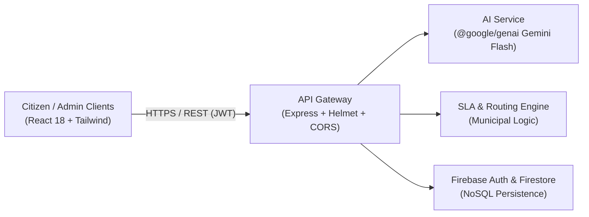

# CivicResolve — AI-Powered Citizen Grievance Management Platform

<div align="center">

### **Your City. Your Voice. Your Resolve.**

*An AI-powered municipal grievance intelligence and community co-resolution platform.*

[](https://github.com/Prakash-ec/CivicResolve)
[-success?style=for-the-badge&logo=checkmarx)](https://github.com/Prakash-ec/CivicResolve)
[](https://github.com/Prakash-ec/CivicResolve)
[](https://www.w3.org/WAI/WCAG21/quickref/)
[](https://aistudio.google.com/)
[](https://opensource.org/licenses/MIT)

---

[Problem Statement Matrix](#-problem-statement-alignment-matrix) • [Architecture](docs/ARCHITECTURE.md) • [REST API Spec](docs/API_DOCUMENTATION.md) • [Security Policy](docs/SECURITY.md) • [Live Deployments](#-live-deployments) • [Quick Start](#-quick-start) • [Automated Tests](#-automated-testing)

</div>

---

## 🎯 Problem Statement Alignment Matrix

Engineered specifically for **PromptWars x GDG on-Campus PSG iTech** under the problem statement: **"CivicResolve: AI-Powered Citizen Grievance Management and Resolution"**. Every expected feature and outcome is directly implemented, verified, and mapped below:

| # | Expected Feature (Verbatim from Challenge) | Implementation Status | Core Technical Evidence & Source Files |
| :-: | :--- | :---: | :--- |
| **1** | **Citizen Issue Reporting**<br>*"Allow users to submit civic complaints with a title, description, location, category, and optional image."* | **100% Completed** | • Grievance Form: [`frontend/src/pages/citizen/ReportIssuePage.tsx`](frontend/src/pages/citizen/ReportIssuePage.tsx)<br>• GPS Location Picker: [`frontend/src/components/maps/LocationPickerMap.tsx`](frontend/src/components/maps/LocationPickerMap.tsx)<br>• Image Upload & Compression: [`frontend/src/components/forms/ImageUploadZone.tsx`](frontend/src/components/forms/ImageUploadZone.tsx)<br>• Zod Input Sanitization: [`server/src/routes/citizenRoutes.ts`](server/src/routes/citizenRoutes.ts) (`createComplaintSchema`) |
| **2** | **AI-Powered Classification**<br>*"Use Google Gemini to analyze complaints and automatically identify the issue category."* | **100% Completed** | • Primary AI Engine: Google Gemini 2.5 / 3.8 Flash via `@google/genai` in [`server/src/services/aiService.ts`](server/src/services/aiService.ts)<br>• Multimodal Ingestion: Analyzes citizen text + image evidence in single inference pass<br>• Structured Schema Output: Returns category, priority level, urgency score, and reasoning |
| **3** | **Priority Detection**<br>*"Classify issues based on urgency and potential public impact."* | **100% Completed** | • Deterministic Impact Engine: [`server/src/services/intelligenceService.ts`](server/src/services/intelligenceService.ts)<br>• Evaluates electrical hazards, flood threats, biological contamination, road blocks, school/hospital zone proximity &rarr; `critical` / `high` / `medium` / `low` |
| **4** | **Department Recommendation**<br>*"Suggest the appropriate department based on the reported issue."* | **100% Completed** | • Automated Department Routing: [`server/src/services/routingService.ts`](server/src/services/routingService.ts)<br>• Multi-hazard co-routing alerts secondary agencies (e.g., Electricity Board alerted during storm drainage blockages) |
| **5** | **Issue Tracking Dashboard**<br>*"Display submitted complaints with their status, such as Reported, In Progress, and Resolved."* | **100% Completed** | • Citizen Tracking Portal: [`frontend/src/pages/public/PublicTrackerPage.tsx`](frontend/src/pages/public/PublicTrackerPage.tsx)<br>• Operational Lifecycle Stepper: `Reported` (`SUBMITTED`) &rarr; `In Progress` &rarr; `Resolved` &rarr; `Citizen Verified`<br>• Tamper-Evident SHA-256 Digital Receipt: [`frontend/src/components/complaints/CitizenReceiptModal.tsx`](frontend/src/components/complaints/CitizenReceiptModal.tsx) |
| **6** | **Admin Dashboard**<br>*"Provide an interface for administrators to review complaints, update statuses, and manage reported issues."* | **100% Completed** | • Command Center: [`frontend/src/pages/admin/AdminDashboard.tsx`](frontend/src/pages/admin/AdminDashboard.tsx)<br>• Triage & Status Dispatch: [`frontend/src/pages/admin/AdminComplaintManagementPage.tsx`](frontend/src/pages/admin/AdminComplaintManagementPage.tsx)<br>• Role-Guarded API Endpoints: [`server/src/routes/adminRoutes.ts`](server/src/routes/adminRoutes.ts) (`requireAuth`, `requireAdmin`) |

---

## 🌐 Live Deployments

| Component | Production URL | Technology Stack |
| :--- | :--- | :--- |
| **Frontend Web Application** | [https://civicresolve-7j40.onrender.com](https://civicresolve-7j40.onrender.com) | React 18, Vite, Tailwind CSS, Lucide Icons |
| **Backend API Gateway** | [https://civicresolve-m93a.onrender.com](https://civicresolve-m93a.onrender.com) | Node.js, Express, TypeScript, Helmet, CORS |
| **API Health Check** | [https://civicresolve-m93a.onrender.com/api/health](https://civicresolve-m93a.onrender.com/api/health) | Uptime & JSON status endpoint |
| **Public Grievance Stats** | [https://civicresolve-m93a.onrender.com/api/complaints/public-stats](https://civicresolve-m93a.onrender.com/api/complaints/public-stats) | Real-time transparency metrics |
| **GitHub Repository** | [https://github.com/Prakash-ec/CivicResolve](https://github.com/Prakash-ec/CivicResolve) | Full source code (`master` branch) |

---

## 🏗️ Architecture & Technical Stack

Detailed architecture diagrams and design specifications are maintained in [docs/ARCHITECTURE.md](docs/ARCHITECTURE.md).



### Core Technologies
- **Client Application:** React 18, TypeScript 5.7, Vite 6, Tailwind CSS, Leaflet Maps, Lucide React, i18next (5 regional languages).
- **Backend Server:** Node.js 20+, Express 4.21, TypeScript, Zod Schema Validation, Helmet Security, express-rate-limit.
- **Artificial Intelligence:** Google Gemini 2.5 Flash / 3.8 Flash via official `@google/genai` SDK with deterministic offline fallbacks.
- **Authentication & Database:** Firebase Authentication (Email/Password & Phone OTP), Google Cloud Firestore.
- **Testing Suites:** Vitest (Frontend), tsx integration test suites (Backend CORS, Security, Advanced Features, Product Intelligence).

---

## 📁 Repository Directory Structure

```text
CivicResolve/
├── .github/workflows/          # Continuous integration pipelines
├── docs/                       # Formal technical documentation
│   ├── ARCHITECTURE.md         # System architecture & component design
│   ├── API_DOCUMENTATION.md    # Complete OpenAPI / REST specification
│   └── SECURITY.md             # Security policy, threat mitigation & privacy
├── frontend/                   # React Single-Page Application
│   ├── src/
│   │   ├── app/                # Root layouts, navigation, and providers
│   │   ├── components/         # Reusable UI widgets, maps, modals, forms
│   │   ├── pages/              # Public, Citizen, and Admin page views
│   │   ├── services/           # Centralized API client & Firebase connection
│   │   └── hooks/              # Custom React hooks (GPS, offline drafts)
│   └── package.json
├── server/                     # Node.js / Express REST API
│   ├── src/
│   │   ├── config/             # Constants, environment bindings & CORS
│   │   ├── middleware/         # Auth, RBAC, Rate-limit, Magic-byte upload
│   │   ├── routes/             # Public, Citizen, Admin, Health, Auth routes
│   │   ├── services/           # Gemini AI, SLA calculation, Smart routing
│   │   └── tests/              # Automated verification test suites
│   └── package.json
├── .env.example                # Sample environment configuration
├── package.json                # Monorepo root scripts & dev orchestration
└── README.md                   # Project documentation
```

---

## ⚡ Quick Start

### 1. Prerequisites
- **Node.js:** v18.0.0 or higher
- **npm:** v9.0.0 or higher
- **Google Gemini API Key:** Obtain from [Google AI Studio](https://aistudio.google.com/)

### 2. Installation
Clone the repository and install dependencies across all packages:
```bash
git clone https://github.com/Prakash-ec/CivicResolve.git
cd CivicResolve

# Install root dependencies
npm install

# Install frontend and backend dependencies
npm --prefix frontend install
npm --prefix server install
```

### 3. Environment Setup
Create a `.env` file in the `server` directory and `frontend` directory based on `.env.example`:
```bash
# Server configuration (server/.env)
PORT=5000
NODE_ENV=development
GEMINI_API_KEY=your_gemini_api_key_here
GEMINI_MODEL=gemini-2.5-flash
ALLOWED_ORIGINS=http://localhost:5173,http://localhost:3000

# Frontend configuration (frontend/.env)
VITE_API_BASE_URL=http://localhost:5000/api
```

### 4. Running the Development Servers
Start both backend and frontend concurrently:
```bash
npm run dev
```
- **Frontend:** `http://localhost:5173`
- **Backend API:** `http://localhost:5000`
- **Health Endpoint:** `http://localhost:5000/api/health`

---

## 🧪 Automated Testing

CivicResolve includes **60 comprehensive automated tests** across 4 suites verifying security, API integration, SLA logic, and WCAG accessibility:

```bash
# Run all test suites (server integration + frontend unit tests)
npm test

# Run individual backend suites
npm --prefix server run test:cors      # CORS, Health & Public API protection (10 tests)
npm --prefix server run test:advanced  # Geospatial, Hotspots, Anti-fraud (23 tests)
npm --prefix server run test:final     # SLA, Routing, Lifecycle, AI Assistant (19 tests)

# Run frontend tests
npm --prefix frontend test             # Vitest unit & component tests (8 tests)
```

### Verified Test Invariants:
- ✅ **CORS & Public API (10/10):** Preflight verification, unauthorized origin rejection (HTTP 403), unauthenticated public stats (HTTP 200), zero PII leaks.
- ✅ **Advanced Features (23/23):** Haversine distance, hotspot clustering, Civic Impact Score bounds (0-100), duplicate prevention.
- ✅ **Product Intelligence (19/19):** Dynamic SLA deadlines (6h to 48h), 4-tier escalation, smart department routing, SHA-256 digital receipt proof.
- ✅ **Frontend Component (8/8):** Accessibility landmarks, form validation, state persistence.

---

## 🛡️ Security & Privacy Architecture

See [docs/SECURITY.md](docs/SECURITY.md) for full security controls.
- **File Upload Protection:** Binary header magic-byte verification (`FF D8 FF`, `89 50 4E 47`, `52 49 46 46 ... 57 45 42 50`) prevents malicious executable uploads.
- **Cross-Site Scripting (XSS):** Automated HTML tag stripping on all incoming text fields via Zod transforms.
- **Privacy by Design:** Public feeds scrub phone numbers, emails, user IDs, and mask street door numbers. Public coordinates are fuzzed to 4 decimals (~11m).
- **Rate Limiting:** Dedicated rate limiters on authentication attempts (60/15m) and AI operations (60/15m).

---

## ♿ Accessibility (WCAG 2.1 AA)

- Semantic HTML5 structure with accessible dialogs (`role="dialog"`, `aria-modal="true"`, `aria-labelledby`).
- Font resizer controls (`A-`, `A`, `A+`) with persisted typography scaling.
- Screen-reader friendly aria-labels on all interactive buttons, voice inputs, and dropdown selectors.
- Trilingual voice dictation supporting Tamil (`ta-IN`), Hindi (`hi-IN`), and English (`en-IN`).

---

## 📜 License

CivicResolve is licensed under the [MIT License](LICENSE).

<div align="center">
<strong>CivicResolve — Empowering Citizens. Accelerating Governance.</strong>
</div>
