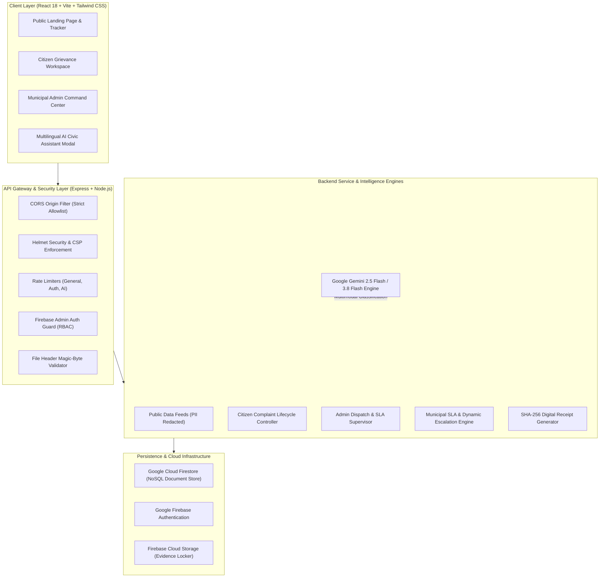
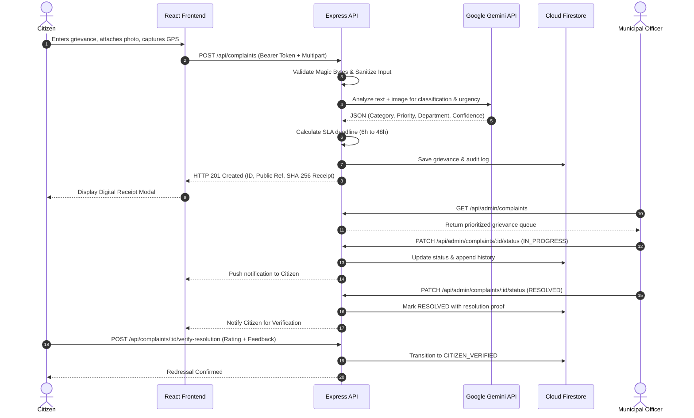

# CivicResolve — System Architecture & Design Specification

> **AI-Powered Citizen Grievance Management & Municipal Redressal Platform**  
> *Google DeepMind PromptWars x GDG on-Campus PSG iTech Hackathon*

---

## 1. Architectural Overview

CivicResolve is built using a modern, decoupled, cloud-native architecture designed for high availability, sub-second response times, and resilience under municipal-scale concurrent traffic. It links citizens directly to municipal governance departments through an automated AI intelligence pipeline powered by Google Gemini.

---

## 2. Layered Component Architecture

### 2.1 Frontend Presentation Tier (`frontend/`)
The frontend is constructed as a React Single-Page Application (SPA) compiled with Vite and styled using Tailwind CSS and Lucide React icons.

- **Component Modularity:**
  - `src/app/layouts/`: Responsive top navigation bar, quick helpline ticker, regional language switcher, and accessible mobile navigation drawer.
  - `src/pages/public/`: Landing page with live transparent grievance statistics, public resolution feed, interactive map explorer, and public grievance tracker by reference ID.
  - `src/pages/citizen/`: Citizen grievance filing form (with voice dictation, GPS auto-detect, and photo upload), personal grievance history dashboard, and notification center.
  - `src/pages/admin/`: Municipal administration command center, department dispatch review, image evidence audit workspace, and SLA analytics.
  - `src/components/ai/`: Floating multilingual AI assistant supporting 5 regional languages (English, Tamil, Hindi, Telugu, Kannada) for conversational guidance.
  - `src/components/complaints/`: Verifiable digital citizen receipts with SHA-256 cryptographic verification hashes.

- **State Management & Offline Capability:**
  - Real-time React context providers for Authentication (`AuthContext.tsx`).
  - Offline-first draft storage via IndexedDB/localStorage with automatic synchronization upon network reconnection (`useOfflineDrafts.ts`).

### 2.2 API & Gateway Tier (`server/src/index.ts`)
The Express application acts as an authenticated RESTful gateway with strict middleware chains:
- **CORS Protection:** Explicit allowlist validating origins (`https://civicresolve-7j40.onrender.com` in production, `localhost` in local development), rejecting unknown origins with HTTP `403`.
- **Security Headers (Helmet):** Content Security Policy (CSP), HTTP Strict Transport Security (HSTS) with 1-year max-age, MIME sniffing prevention (`X-Content-Type-Options: nosniff`), and frame guard against clickjacking.
- **Granular Rate Limiting:**
  - `generalLimiter`: 200 requests / 15 minutes across all API endpoints.
  - `authLimiter`: 60 requests / 15 minutes on `/api/auth` to prevent brute-force attacks.
  - `aiLimiter`: 60 requests / 15 minutes on `/api/ai` to prevent quota exhaustion.
- **Order of Route Mounting:** Public endpoints (`/api/complaints/public-stats`, `/api/complaints/public-feed`) are mounted before parameterized citizen routes (`/api/complaints/:id`) to prevent wildcard intercept.

### 2.3 Intelligence & AI Tier (`server/src/services/aiService.ts`)
CivicResolve integrates **Google Gemini 2.5 Flash / 3.8 Flash** via the official `@google/genai` SDK:
- **Multimodal Classification:** Analyzes both citizen-supplied textual descriptions and photographic evidence in a single inference call.
- **Urgency Scoring:** Evaluates real-time municipal risk (0-100 score) based on public safety hazards, electrical risks, flood threats, and road obstructions.
- **Department Routing:** Recommends the optimal municipal authority (e.g., Roads & Highways, Water Supply & Sewerage, Electricity Board, Solid Waste Management).
- **Graceful Deterministic Fallback:** In environments without an active API key or when API rate limits are encountered, an in-memory deterministic expert rule engine ensures zero application downtime while returning identical JSON schemas.

### 2.4 Data Persistence & Security Tier
- **Firebase Authentication:** Multi-factor and token-based identity verification providing cryptographically signed JWT ID tokens.
- **Google Cloud Firestore:** Scalable NoSQL document store with strict collection segregation:
  - `complaints`: Core grievance records with full lifecycle state, priority scores, and SLA metadata.
  - `complaint_history`: Immutable append-only audit trail logging every status change and actor.
  - `departments`: Municipal administrative departments and assigned supervisor contacts.
  - `notifications`: Push-style citizen alerts for grievance milestones.

---

## 3. End-to-End Complaint Lifecycle Sequence

The sequence diagram below illustrates the exact request-response lifecycle from citizen submission through AI classification to resolution and citizen verification:

---

## 4. Design Principles & Engineering Standards

1. **Separation of Concerns:** Business logic resides strictly in dedicated services (`aiService.ts`, `slaService.ts`, `receiptService.ts`), completely decoupled from route controllers.
2. **Defensive Programming:** Every incoming payload is validated against strict Zod schemas with automatic HTML stripping to prevent stored XSS attacks.
3. **Data Privacy by Default (GDPR/Digital Data Protection):** All public endpoints automatically scrub Personally Identifiable Information (PII) including phone numbers, emails, user IDs, and exact building door numbers.
4. **Resilience & Fault Tolerance:** Multi-tiered fallbacks ensure the application operates continuously even in isolated test environments or during cloud API rate limits.
5. **Universal Accessibility (WCAG 2.1 Level AA):** Full keyboard navigability, semantic ARIA roles (`role="dialog"`, `aria-modal="true"`, `aria-expanded`), high-contrast color palettes, and text size scaling.
