# ADVANCED FEATURE IMPLEMENTATION PLAN & ARCHITECTURE

## 1. Implementation Phasing Roadmap

```mermaid
flowchart TD
    subgraph Phase A["Phone & Authentication Security"]
        A1["Firebase Web reCAPTCHA"] --> A2["SMS OTP Dispatch"]
        A2 --> A3["linkWithCredential Binding"]
        A3 --> A4["Server-side Token Phone Verification"]
    end

    subgraph Phase B["Civic Impact Intelligence"]
        B1["Haversine Metric Computation"] --> B2["Geospatial Clustering (150m)"]
        B2 --> B3["Civic Impact Score (0-100)"]
        B3 --> B4["Explainable Action Recommendations"]
    end

    subgraph Phase C["Community Grievance Validation"]
        C1["Proximity Duplicate Detection"] --> C2["Community Confirmation ('Yes, This Issue Exists')"]
        C2 --> C3["Transactional Upvotes & Priority Escalation"]
        C3 --> C4["ResolveRewards™ Credit Distribution"]
    end

    subgraph Phase D["Multimodal Evidence Verification"]
        D1["File Upload Inspection"] --> D2["Gemini 2.5 Flash Multimodal Verification"]
        D2 --> D3["Tampering & Authenticity Scoring"]
        D3 --> D4["Admin Forensic Review Console"]
    end

    subgraph Phase E["Voice & Accessibility"]
        E1["Web Speech Recognition Engine"] --> E2["Trilingual Voice Input (ta/hi/en)"]
        E2 --> E3["5 Indian Language Topbar Selector"]
    end
```

---

## 2. Component Specifications

### 2.1 Geospatial Haversine & Clustering Engine (`server/src/services/intelligenceService.ts`)
- **Formula:** Haversine great-circle calculation using Earth mean radius ($R = 6,371,000 \text{ m}$).
- **Clustering:** Aggregates grievances within configurable radius ($100\text{m} \le r \le 300\text{m}$, default $150\text{m}$).
- **Centroid Calculation:** Mean latitude and longitude of clustered incidents.

### 2.2 Civic Impact Score Algorithm
$$\text{ImpactScore} = \min(100, W_{\text{unresolved}} + W_{\text{hazard}} + W_{\text{density}} + W_{\text{confirmations}} + W_{\text{overdue}})$$
- **Unresolved Backlog:** 30 pts (Active vs Resolved)
- **Hazard Level:** 25 pts (Electrical: 25, Sewage: 22, Water: 20, Roads: 18)
- **Proximity Density:** 20 pts ($\ge 5$ complaints in cluster)
- **Community Confirmations:** 15 pts (Citizen validations + phone verified bonus)
- **Overdue SLA Age:** 10 pts ($>72\text{ hours}$ without resolution)

### 2.3 Account Linking Architecture (`frontend/src/features/auth/AuthContext.tsx`)
- Modular Firebase v11 `linkWithCredential(auth.currentUser, credential)`.
- Eliminates account splitting and unifies citizen grievance tracking.

### 2.4 Voice Assistant (`frontend/src/components/forms/VoiceInputButton.tsx`)
- Standard Web Speech API with real-time waveform visualization, continuous interim transcripts, and instant form injection.
